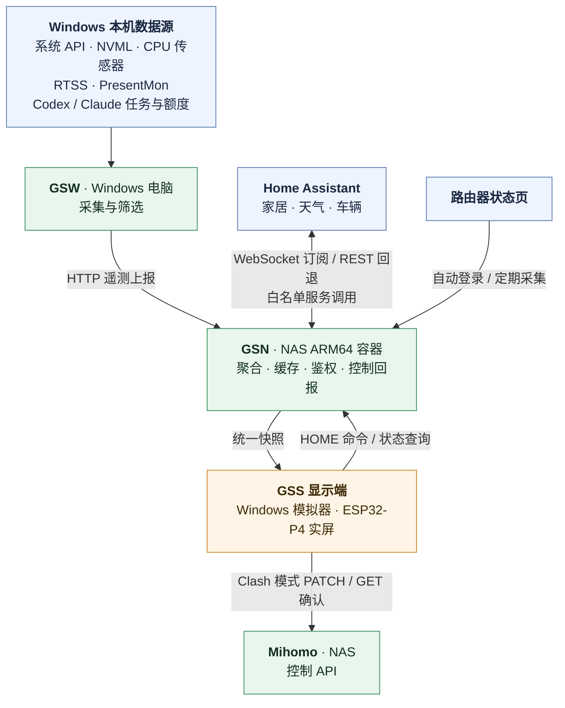

# GSO STATUS

面向桌面副屏的状态与家居控制系统。常驻模块为 **WIN / VIBE / NET / HOME**，另有按配置出现的 **PRINT / CAR / NAS** 卡片；采集、聚合与显示分开运行。

- **GSS — GSO STATUS SCREEN**：显示端，包含ESP32-P4实屏固件与Windows模拟器。
- **GSW — GSO STATUS WIN**：Windows采集端，提供硬件、游戏及VIBE状态。
- **GSN — GSO STATUS NAS**：NAS聚合端，汇总GSW、Home Assistant与路由器数据，并代理家居控制。

GSS是软件名称；**ESP32-P4**仍表示芯片型号，厂家资料、驱动和原厂备份中的硬件名称保留。

## 当前版本与进度

更新：2026-10-18。

| 组件 | 版本 | 状态 |
|------|------|------|
| GSS 显示端（模拟器 + 实屏固件） | **0.7.23** | 模拟器自检、模型测试、共享代码校验通过，固件编译通过；固件未烧录 |
| GSW Windows 采集端 | **0.1.19** | 本机运行 |
| GSN NAS 聚合端 | **0.1.33** | 已在 NAS 上以特权模式运行 |

最近更新（完整记录见[版本记录](docs/版本记录.md)）：

- **GSS 0.7.23**：NET卡片底部状态行改为 GSN/GSW/HA。
- **GSS 0.7.22 / GSN 0.1.33**：NAS详情页新增“硬盘健康”页（白话解读SMART），硬盘需留意/有风险时左侧栏提示；SMART在NAS上读取正常。
- **GSS 0.7.21**：PRINT卡片“已完成”右侧显示收到时间，模型图居中、进度下移到底部。
- **GSS 0.7.20 / GSN 0.1.31**：HDD状态改为已唤醒/已休眠并显示今日唤醒次数；读不到硬盘电源状态时按“最后一次读写后300秒休眠”推断；GSN 0.1.32起提供`nas.disk_read_asleep`。NAS配置里`disk_read_asleep:false`、`disk_interval_seconds:600`，避免我们自己的SMART读取不断重置硬盘的待机计时。
- **GSS 0.7.18–0.7.19 / GSN 0.1.29–0.1.30**：NAS卡片和详情页的eMMC、HDD各显示占用与读写速率（内核I/O计数器，不唤醒硬盘）。
- **GSS 0.7.15–0.7.17 / GSN 0.1.27–0.1.28**：新增NAS主机状态卡片；WIN硬盘区重排，显示读/写速率和响应时间。
- **GSS 0.7.12–0.7.13 / GSN 0.1.24–0.1.25**：新增CAR车辆卡片和详情页（零跑，经HA读取，控制默认关闭，见[HOME接入与控制](docs/HOME接入与控制.md)）。
- **GSS 0.7.8–0.7.9 / GSN 0.1.21–0.1.23**：新增PRINT卡片（拓竹打印机，局域网MQTT只读，见[GSN-host手动部署](docs/GSN-host手动部署.md)）。
- **GSS 0.7.6–0.7.7**：固件和模拟器共用同一套界面与数据模型；VIBE接入Claude额度与任务状态，界面按6.2寸屏调整字号与配色。

开发板已寄回。GSS已移除售后页面、写入故障诊断及故障分区避让代码；当前为单factory布局，应用从`0x20000`连续使用剩余15.875 MiB，没有双OTA。0.7.6及之后的版本尚未在更换后的正常板上验证，新的实机帧率、触摸体验和长期稳定性待换板验收。旧0.7.2实测动画约5.83 FPS，不能把约47 Hz面板扫描率等同于动画帧率。

## 系统架构



GSW负责采集与筛选，不绘制页面。GSN负责把不同来源整理成统一快照、计算来源状态并执行经过授权的HOME命令。GSS负责呈现与触控，实屏通过Wi-Fi直接访问GSN；USB仅用于供电、烧录和诊断，没有PC业务桥接。

模拟器与实屏复用`simulator/real_ui.inc`、`simulator/wifi_ui.inc`及`shared/`模型、Wi-Fi凭据校验逻辑。模拟器Wi-Fi仅供界面展示和交互预览，扫描列表与连接状态为内存中的示例，关闭即清除；不接入无线网卡，不改变电脑网络。业务数据继续通过Windows网络直连GSN。Windows网络适配使用WinHTTP，实屏适配使用ESP-IDF HTTP与C5无线协处理器。网络采集在后台进行，交互期间合并延后更新界面；按钮反馈与滑块操作保持即时响应。

HOME命令包含独立ID、有效期和授权信息。发送结果丢失时只查询原命令状态，不重复提交设备操作。来源不可用时显示相应状态，不生成硬件读数、游戏帧率或历史额度充当实时数据。

## 界面模块

- **WIN**：CPU/GPU占用、频率、温度与功耗，RAM/VRAM容量及频率，硬盘可用容量；游戏模式只在全屏（含无边框全屏）窗口的进程触发，展示游戏名称、图标、FPS及渲染延迟。RTSS提供测帧样本，GSW结合全屏窗口条件筛选游戏，PresentMon跟踪选定进程。
- **VIBE**：任务状态、当前会话名称、持续时长与额度，来源为Codex与Claude；详情页另列两个客户端的在线状态与当日消耗token；卡片只显示当前工作的那一个（图标与名称并排），详情页保留两行额度。无任务为绿色“就绪”；运行任务连续60秒无新事件转为就绪（`wrap_up`、提问、计划确认后3秒），新事件恢复运行；无法确认状态时显示“未运行”，卡片移到最右侧，遥测短暂缺口保留上一状态20秒；来源读取失败保留异常提示。
- **NET**：VPN流量仪表（总量显示在标题行，下方为距每月24日重置的整天数和重置日期；详情页仪表下方为NAS两块存储的容量）、Clash模式、代理/拦截服务状态、订阅及规则更新时间、规则数量和已接入设备数量。HA已有数据从HA读取，路由器专属数据由GSN采集。Clash使用一体式“规则／全局／直连”滑动控件，切换后读取控制器实际模式。卡片底部一行显示GSN、GSW、HA的运行状态；详情页另有代理/拦截等服务状态行。
- **HOME**：设备状态卡片与圆形开关（主页间距加大，详情页卡片按设备能力自适应高度）；详情支持空调温度/模式、灯光亮度/色温、风扇风量/模式等实体实际支持的操作。天气简略信息、每日/每小时预报及环境光自动亮度也由HA数据驱动。
- **PRINT**（拓竹打印机，未配置则不显示）：任务名、状态、进度、剩余时间、层数和模型缩略图，完成后显示收到时间；喷嘴/热床温度在详情页。默认排在最后，打印中自动移到VIBE后面。GSN只订阅打印机局域网MQTT，不发送控制命令。
- **CAR**（零跑车辆，经HA集成读取，未配置则不显示）：状态、续航、电量、充满时间、开闭锁与刷新、车内温度、总里程、能耗；详情页含胎压、车窗/后备箱、充电功率。控制默认关闭，车辆PIN只留在HA集成选项里。
- **NAS**（GSN读到主机状态才显示，位置紧跟NET）：负载、内存、SoC/HDD温度，eMMC与HDD的占用和读写速率，HDD已唤醒/已休眠及今日唤醒次数；详情页“硬盘健康”用白话解读SMART，硬盘需留意/有风险时左侧栏提示。读硬盘信息不唤醒休眠中的机械盘。

## 快速启动模拟器

使用现有NAS服务时，双击根目录的 **`启动NAS模式.cmd`**。它启动GSW与`artifacts/GSS-Simulator.exe`，分别读取`config/gsw-nas.json`和`config/display-nas.json`。

只启动模拟器：

```powershell
.\artifacts\GSS-Simulator.exe --config .\config\display-nas.json
```

本机联调使用`启动本机联调.cmd`，启动本机GSN、GSW和模拟器；停止用`停止本机联调.cmd`。`启动原型.cmd`打开当前正式界面并使用本机显示配置，不再加载历史演示数据。

本地私有配置不随发布包提供。新环境从`config/*.example.json`开始配置；现有NAS地址为`http://192.168.124.14:2780`。Mihomo控制使用私有配置中的`mihomo_url`与`mihomo_token`，NAS模式现有配置已补齐。配置文件与令牌不要放进公开固件包。

Claude桌面版额度由GSW读取：在`config/gsw*.json`设置`"ClaudeUsageApi": true`（默认关闭）。它只读取桌面版自己的令牌缓存与用量文件，令牌只在内存中使用、只发往`api.anthropic.com`，范围与频率见[版本记录](docs/版本记录.md)。终端版Claude Code可用`GSW.exe --install-claude-statusline`接入桥接。

## 目录定义

```text
ESP32-P4-Sidecar/
├─ main/                GSS实屏入口、板级初始化、Wi-Fi、网络及偏好适配
├─ simulator/           GSS共享LVGL界面、字体、主题与Windows模拟器适配
├─ shared/              两种显示环境共用的数据模型、快照解析、亮度、Wi-Fi凭据校验和命令策略
├─ gsw/                 GSO STATUS WIN，C#采集端及独立CPU传感器工作进程
├─ gsn/                 GSO STATUS NAS，Go聚合服务、HA/路由器接入与HOME控制
├─ contracts/           统一数据契约、JSON Schema及契约验证
├─ components/          本地ESP-IDF组件：LCD/触摸驱动、LVGL与JSON集成
├─ managed_components/  ESP-IDF管理的依赖，如ESP-Hosted及远程Wi-Fi
├─ config/              配置模板、私有本地配置及GSS构建默认配置
├─ scripts/             构建、打包、启动、部署同步及验证脚本
├─ tests/               模型、采集、网络、HOME策略及Wi-Fi等独立测试
├─ vendor/              固定版本的第三方源码与许可证
├─ tools/               本地构建工具、运行时、传感器及测帧依赖
├─ docs/                进度、硬件接入、部署、功能说明和验证记录
├─ 厂家资料/            商家提供的板卡与屏幕原始资料
├─ fixtures/            屏幕支架（夹具）的SCAD、STL与3MF文件
├─ assets/              界面用到的图片素材（如车辆图）
├─ artifacts/           可交付程序、镜像、固件、验证报告及历史归档
├─ build/               ESP-IDF生成的构建缓存，不是源码入口
└─ work/                本地临时文件、联调记录、测试输出（`work/qa`存放自检截图）及私有备份
```

`artifacts/GSS/`为已打包的GSS固件和烧录清单（目前是0.7.12，更新版本的编译产物在`build/`，尚未打包），`artifacts/GSS-Simulator.exe`为模拟器，`artifacts/GSW/`为Windows采集端，`artifacts/NAS/`为ARM64容器镜像，`artifacts/verification/`为验证摘要。`artifacts/P4/`只保留最后一个在真实板上验证过的0.7.2固件包；`artifacts/GSO-STATUS-WIN-0.1.19-win-x64.zip`为当前GSW发布包，更早的发布包在`artifacts/project-history/old-gsw-releases/`。

根目录`CMakeLists.txt`与`partitions.csv`定义GSS固件工程和分区；`PLAN.md`是范围与验收基线，`toolchains.lock.json`、`global.json`、依赖锁文件记录工具链和依赖版本。工作目录暂保留旧名称，避免改变本机工作区及外部路径。

## 构建与验证

在项目根目录运行：

```powershell
# GSS模拟器 / 独立自检程序
.\scripts\build.ps1
.\scripts\build.ps1 -Test
.\运行自检.cmd

# 模型/解析/GSN防抖测试，并检查模拟器与固件源码保持同一套（不编译固件）
.\scripts\test-model.ps1
python .\scripts\verify-shared-code.py

# GSS实屏固件；使用本机EIM登记的ESP-IDF
.\scripts\build-gss.ps1
python .\scripts\package-gss.py

# GSW与本机GSN；NAS ARM64镜像单独构建
.\scripts\build-services.ps1
.\scripts\build-gsn-linux.ps1
python .\scripts\package-gsn.py
```

Python打包固件前，需在已加载ESP-IDF环境的终端完成固件构建；Python工具、测试所需依赖见[依赖与接入清单](docs/依赖与接入清单.md)。`build-gss.ps1 -Flash`会在构建后烧录COM4，更换正常板后再执行。普通交付的具体地址、长度和SHA256以`artifacts/GSS/flash-manifest.json`为准。

CPU温度与包功耗依赖受保护的独立传感器任务；正常GSW无需管理员权限。安装及数据边界见[CPU温度与功耗](docs/CPU温度与功耗.md)。字体只在页面增加新文字时按需重新生成（`python scripts/generate_font.py --sizes 20`，需要Pillow和系统SimHei），正常构建直接使用已生成源码；VIBE的Codex/Claude图标由`scripts/generate-provider-icons.ps1`从本机已安装的应用生成。

## NAS部署

NAS使用host网络、端口2780，配置挂载`/hdd0/GSN/config → /app/config`，读写，不需要端口映射。当前配置位于`\\192.168.124.14\hdd0\GSN\config`，镜像上传位置为`\\192.168.124.14\hdd0\我的镜像`。

`scripts/sync-nas.ps1`按既有授权备份并同步配置及镜像，保留私有路由器凭据并校验SHA256。镜像导入、容器替换、挂载和重启由用户手动操作。当前镜像为`artifacts/NAS/GSN-0.1.33-arm64.docker.tar`（保留上一版0.1.32备用）；容器需特权模式、不设用户覆盖（读硬盘SMART需要），NAS上没有终端，一切在NAS界面里操作。GSN的休眠相关配置见`nas.disk_read_asleep`、`nas.disk_interval_seconds`。

## 文档入口

- [完整计划与验收](PLAN.md) · [当前开发进度](docs/开发进度-软件基础版.md)
- [版本记录](docs/版本记录.md)（0.7.2–0.7.23）· [性能排查](docs/性能排查-2026-10-17.md) · [6.2寸屏界面可读性](docs/界面可读性-6.2寸屏.md) · [旧板寄回与开发交接](docs/售后寄回与开发交接.md)
- [GSS实机烧录与恢复](docs/GSS实机烧录与恢复.md) · [GSS Wi-Fi直连](docs/GSS-WiFi接入.md)
- [硬件规格](docs/硬件规格.md) · [数据来源核实](docs/数据来源逐项核实-2026-10-15.md)
- [GSN host部署](docs/GSN-host手动部署.md) · [HOME接入与控制](docs/HOME接入与控制.md)
- [RTSS采集设置](docs/RTSS副屏采集设置.md) · [依赖与接入清单](docs/依赖与接入清单.md)

Flash 复测等已退役的诊断文档和证据归档在`artifacts/project-history/`（`retired-docs.zip`、`retired-p4-evidence.zip`、`retired-flash-diagnostics.zip`），原厂固件备份保留在根目录；它们不是当前正常板的构建或部署步骤。实物控制、真实游戏兼容性和长期稳定性以对应验收记录为准。
