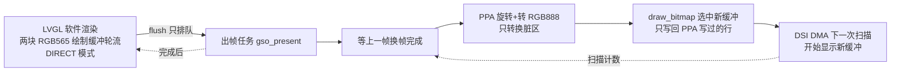

# 性能排查

更新：2026-10-20（香港时间）。本文是 GSS / GSW / GSN 性能问题的唯一记录，合并了 10-17 排查、10-18 复查、10-18 对照厂家仓库，以及 10-20 新板上的三轮优化。当前版本：GSS 1.0.0（正式版，不再继续优化）、GSW 0.1.20、GSN 0.1.34。

证据级别：

- **板上实测**：0.7.2 旧板一次成对测试；2026-10-20 新板（P4 v3.2）上三轮逐项改进，见“2026-10-20 新板实测”“第二轮”“第三轮”。
- **本机实测**：在开发机上跑出来的数据。像素数与架构无关，可以直接用；毫秒数只能做相对比较，不能换算成 P4 帧率。
- **推断**：来自代码、sdkconfig、IDF 源码或厂家资料，没有经过测量。

## 结论

1. **GSS 1.0.0 的板上水平**：打开详情页到首帧约 88ms；拖动卡片条约 23 帧/秒（帧间隔 42.7ms）；开始拖动时冻结卡片约 35ms。起点是 0.7.29：每帧 42ms，导航 149ms。用户已确认效果满意，1.0.0 起不再继续做性能优化。
2. **剩下的时间花在哪**（留作记录，不再处理）：
   - HOME 详情页建页面约 97ms：这台板子接了 13 个设备，时间花在建卡片和填内容上。其他页 19–30ms。
   - 拖动时，渲染和 PPA 同时访问 PSRAM，互相拖慢（渲染约 34ms、PPA 约 19ms，并行进行）。
3. **重复重绘已修掉**：遥测刷新时颜色、边框值相同就不再设置。VIBE、NET 详情页每次刷新的重绘量从 579kpx 降到约 16kpx，HOME 从 278kpx 降到 10kpx。
4. **试过但不可行、已撤销的**：L2 缓存 256KB（内部 RAM 不够，Wi-Fi 断言）、RGB565 直出面板（花屏）、HTTP 连接复用（无收益）。LVGL 9.4 自带的 PPA 绘制单元有缺陷，没有启用。
5. **GSN**：正常路径很快。慢硬盘查询阻塞快照的问题已在 0.1.34 修复。**GSW** 常驻约 4% 单核，不需要处理。

## 问题与优化状态总表

| # | 部分 | 项目 | 状态 | 版本 |
| --- | --- | --- | --- | --- |
| 1 | GSS | 遥测刷新时重复设置文字色、背景色、圆弧色 | 已修复，本机探针验证 | 0.7.7 |
| 2 | GSS | HOME 卡片边框每次刷新都重设 | 已修复，本机探针验证 | 0.7.24 |
| 3 | GSS | 等待换帧移到下一帧写缓冲之前，与渲染重叠 | 已在新板上运行；0.7.36 起由出帧任务承担 | 0.7.7 |
| 4 | GSS | PPA 只转换“本帧和上一帧的脏区” | 已在新板上运行，显示正常 | 0.7.7 |
| 5 | GSS | 拖动、吸附期间可见卡片换成 PSRAM 快照 | 0.7.36 改为不透明快照后才有收益（见第二轮） | 0.7.14 起 |
| 6 | GSS | 换帧时关中断做整屏缓存写回 | 已修复，已在新板上运行 | 0.7.25 起 |
| 7 | GSS | L2 缓存 128KB/64B 改为 256KB/128B | **已撤销**：内部 RAM 只剩约 58KB，连接 Wi-Fi 后 ESP-Hosted 收包缓冲分配失败，断言重启 | — |
| 8 | GSS | 拖动快照用 ARGB8888 | 改为显示格式的不透明快照：冻结 135→79ms，拖动帧 58→47ms | 0.7.36 |
| 9 | GSS | 全局 `-Og` 加断言 | 已改 `COMPILER_OPTIMIZATION_PERF`，板上渲染 -8% | 0.7.30 |
| 10 | GSS | LVGL 只用一个核心绘制 | 已改双绘制单元，板上渲染再 -20% | 0.7.30 |
| 11 | GSS | 面板收 RGB888，PPA 每帧做 565→888 | **已撤销**：COLMOD 0x55 加 RGB565 帧缓冲，右侧花屏、左侧全黑。厂家对这块屏也用 RGB888 | — |
| 12 | GSS | PPA 同步阻塞，不与渲染重叠 | 改为两块绘制缓冲加出帧任务：导航 109→93ms，拖动帧间隔 50→46.5ms；用户目测无撕裂 | 0.7.36 |
| 13 | GSS | Flash DIO 80MHz | 不再需要：0.7.36 起程序和字体从 PSRAM 执行，flash 只在开机时读 | — |
| 14 | GSS | 面板约 47Hz，厂家规格 60Hz | 像素时钟 48→60MHz，实测约 59Hz，等待换帧 4.6→约 1.4ms；用户目测正常 | 0.7.33 |
| 15 | GSS | 触摸 I²C 100kHz；GSN 轮询每秒新建 TCP 连接 | 触摸已改 400kHz，并在按住期间轮询（0.7.35）。HTTP 复用试过：请求 35→33ms，在误差内，已撤销 | 0.7.30 / 0.7.35 |
| 16 | GSN | 慢硬盘查询阻塞缓存快照 GET 和遥测 POST | 已修复，有回归测试 | 0.1.34 |
| 17 | GSW | `ClientActivity` 进程枚举 | 已改为单次 toolhelp 快照，改善在测量波动之内 | 0.1.16 之后的版本 |
| 18 | GSS | 主循环每轮固定睡 5ms | 改为睡到 LVGL 下一个定时器（1–5ms）：导航帧间隔 37→33ms | 0.7.36 |
| 19 | GSS | 代码和字体从 80MHz DIO flash 读取 | 开 `SPIRAM_XIP_FROM_PSRAM`：渲染 -24%，导航 130→109ms，冻结 79→56ms | 0.7.36 |
| 20 | GSS | 用 LVGL 9.4 自带的 PPA 绘制单元做填充和贴图 | **不启用**：它总是画在图层左上角，不管任务位置；每个任务都同步整块缓冲；对齐检查依赖 Kconfig 宏 | — |
| 21 | GSS | 大面积变化时整屏 PPA 转换 | 改为转换脏区的外接矩形：拖动时侧栏不再重转，拖动帧 PPA 23.8→19ms | 1.0.0 |
| 22 | GSS | 冻结时一次拍 5 张快照 | 先拍可见的，两侧邻卡推迟到之后两次定时器处理：冻结 56→35ms | 1.0.0 |
| 23 | GSS | 打开 GAME 页时给开场面板拍整屏快照 | 改为实时绘制：建页面 73→19ms | 1.0.0 |
| 24 | GSS | HOME 详情页一次建满 16 个设备卡片 | 只为实际存在的设备建卡片：109→97ms（13 个设备，收益有限） | 1.0.0 |

## GSS 出帧流程



- 画面是 1280×452 横屏，面板是 452×1280 竖屏。LVGL 画进两块 PSRAM 里的 RGB565 整屏缓冲之一，出帧任务再用 PPA 把它旋转进两块 RGB888 帧缓冲中的后台那块。
- 0.7.36 起，flush 只把这一帧交给 `gso_present` 任务（core1，优先级 5），然后立刻返回，LVGL 开始在另一块缓冲里渲染下一帧。下一次 flush 时才等上一帧出帧完成。LVGL 在每帧开始时会把上一帧改过的区域复制到新缓冲，这个复制只读 PPA 正在读的那块缓冲，所以不用等。
- 第 4 项：后台帧缓冲里存的是两帧前的画面，所以要转换“本帧脏区 ∪ 上一帧脏区”。脏区面积超过整屏 60%、开机或按 GPIO47 翻转后，连续两帧转换整屏。逻辑在 `main/gss_present.h`，`tests/present_test.c` 对照整屏旋转逐像素校验。
- 第 6 项：DMA 每次重新开始扫描时，计数加一。出帧任务要等到 `draw_bitmap` 返回之后又出现一次扫描，才认为旧帧缓冲已空闲。出帧任务和 DMA 中断都在 core1 上，所以不需要关中断。

## 板上基线（0.7.2，旧板）

同一份源码，开关关闭/打开交互优先刷新做成对比较。WIN/NET/HOME/GAME 依次进出，三轮共 24 次导航，使用实时 GSN 数据。原始数据：`artifacts/verification/performance-0.7.2.json`。

| 指标 | 基线 | 候选 |
| --- | --- | --- |
| 每帧平均处理 | 112.1ms | 108.6ms |
| 其中软件渲染 | 83.6ms | 81.4ms |
| 导航到首个完成帧 | 163.0ms | 159.6ms |
| 单帧 P95 | 163.9ms | 163.3ms |
| 导航后 350ms 内完成帧数 | 5.8 帧/秒 | 5.8 帧/秒 |

第 3、4 项设计时用的分项数据：渲染 81ms、PPA 固定约 17ms（与脏区大小无关）、等待换帧约 10ms。按板上渲染时间和本机探针像素数推算，P4 软件渲染约 3Mpx/s：整屏 579kpx 约 180ms，拖动 421kpx 约 130ms，加上 PPA 和等待约 6 帧/秒。要达到 30 帧/秒需要约 17Mpx/s。

## 2026-10-20 新板实测（P4 v3.2）

条件：Wi-Fi 已连接、GSN 在线，开启 `GSO_GSS_BENCHMARK`，开机 15 秒后在 4 个页面间导航 24 次，每组 3 次取平均。渲染/PPA/等待/合计为每帧平均微秒。

| 版本 | 帧/组 | 渲染 | PPA | 等待 | 合计 | 导航事件均值 | 导航 P95 | 内部 RAM |
| --- | --- | --- | --- | --- | --- | --- | --- | --- |
| 0.7.29 基线（-Og） | 96 | 28.3ms | 10.0ms | 4.0ms | 42.3ms | 149ms | 145ms | 200KB |
| 全局 PERF | 100 | 26.6ms | 9.7ms | 3.5ms | 39.8ms | 146ms | 145ms | 206KB |
| + 双绘制单元 | 104 | 21.4ms | 9.4ms | 3.9ms | 34.7ms | 126ms | 114ms | 190KB |
| 0.7.30（+触摸 400kHz） | 105 | 20.9ms | 9.3ms | 4.6ms | 34.8ms | 127ms | 112ms | 189KB |
| + 面板 60MHz（约 59Hz） | 108 | 21.1ms | 9.6ms | 1.4ms | 32.1ms | 132ms | 118ms | 189KB |
| RGB565 直出（已撤销，花屏） | 111 | 19.6ms | 7.2ms | 0.7ms | 27.5ms | 121ms | 109ms | 190KB |

- 0.7.30 起每帧合计 42ms → 35ms（约 -17%），导航响应约 -15%，渲染 -26%。无断言、无重启。
- 双绘制线程优先级设为 3（低于 GUI 任务 4 和 Wi-Fi 相关任务），内部 RAM 少约 16KB，仍有约 190KB。
- 0.7.33：面板像素时钟 48→60MHz（vsync 约 47→59/s）。每帧合计最终约 32ms（基线 42.3ms，约 -24%），导航响应约 132ms（基线 149ms，约 -11%），没有断言，internal 约 190KB。
- RGB565 直出（0.7.32）数字上更好，但板上屏幕右侧花屏、左侧全黑，已撤销。测量数字看不出显示是否正确，改显示链路一定要目测。
- 正式固件（关闭基准）实测 HEALTH：内部 RAM 约 203KB，帧数正常，无重启。

## 2026-10-20 第二轮（0.7.35 → 0.7.36）

条件同上：Wi-Fi 和 GSN 在线，基准开关打开，每组复位跑 2–3 次取平均。这一轮基准新增了建页面耗时和模拟拖动（见“上板测量方法”）。每次只叠加一项，下表每行都包含上面各行的改动。

| 版本 | 导航：渲染 / PPA | 导航到首帧 | 350ms 内帧数 | 建页面 | 拖动：渲染 / PPA | 拖动帧间隔 | 冻结 | 内部 RAM |
| --- | --- | --- | --- | --- | --- | --- | --- | --- |
| 0.7.35 基线 | 20.9 / 9.7ms | 129ms | 64 | 33ms | 44.1 / 17.2ms | 约 70ms（注） | 135ms | 187KB |
| + 主循环按定时器睡 | 20.2 / 9.8ms | 130ms | 66 | 33ms | 41.2 / 16.2ms | 69.8ms | 135ms | 188KB |
| + 不透明快照 | — | — | — | — | 30.2 / 16.6ms | 55.9ms | 79ms | — |
| + 从 PSRAM 执行 | 15.5 / 9.3ms | 109ms | 71 | 30ms | 25.6 / 15.7ms | 50.0ms | 56ms | 177KB |
| + 出帧与渲染重叠（0.7.36） | 15.7 / 10.0ms | 93ms | 77 | 30ms | 36.0 / 23.8ms | 46.5ms | 56ms | 177KB |

注：基线的拖动帧间隔是用旧统计口径测的，那时把吸附结束后的空闲时间也算了进去。表里的约 70ms 取自下一行，因为主循环改动不影响拖动。新口径只统计手指按下或吸附动画进行时。“不透明快照”一行只测了拖动。

- **主循环**：导航阶段的帧间隔从约 37ms 降到 33ms，正好约等于 59Hz 下两个刷新周期，说明已经被刷新周期卡住。拖动和导航首帧没变。
- **不透明快照**：快照生成和贴图都更快。对照实验：完全不用快照时拖动每帧渲染 39.6ms，ARGB8888 快照时 41ms，说明旧快照没有收益。
- **从 PSRAM 执行**：字体和代码读取快了，所有渲染都受益，最明显的一项。代价是 PSRAM 多占 5.8MB、开机约慢 0.3 秒。内部 RAM 少约 10KB，仍有约 177KB。
- **出帧与渲染重叠**：PPA 和下一帧渲染并行，导航到首帧再快约 15%；拖动只快约 7%。两者同时访问 PSRAM，渲染从 25.6ms 涨到 36ms、PPA 从 15.7ms 涨到 23.8ms，但并行后总体仍更快。多占 1.16MB PSRAM（第二块绘制缓冲）。
- **HTTP 复用**：每秒一次的快照请求，每次新建连接平均 35ms，复用连接 33ms，在误差内。时间花在 GSN 生成和传输 28KB 上，局域网建立连接本身只要约 1ms，已撤销。
- **合计（相对 0.7.35）**：导航到首帧 129→93ms（-28%）；拖动约 14→21.5 帧/秒（+50%）；开始拖动的卡顿 135→56ms（-59%）。正式固件运行时，内部 RAM 约 177KB 并保持稳定。

## 2026-10-20 第三轮（0.7.36 → 1.0.0）

条件同上。这一轮的基准还按页面统计建页面耗时（`BENCH4`）：HOME 详情 109ms、GAME 73ms、WIN 30ms、NET 21ms、关闭详情 2ms。

| 版本 | 导航：渲染 / PPA | 导航到首帧 | 350ms 内帧数 | 建页面平均 | 拖动：渲染 / PPA | 拖动帧间隔 | 冻结 | 内部 RAM |
| --- | --- | --- | --- | --- | --- | --- | --- | --- |
| 0.7.36 | 15.7 / 10.0ms | 93ms | 77 | 30ms | 36.0 / 23.8ms | 46.5ms | 56ms | 177KB |
| + 外接矩形转换、先拍可见卡片 | 15.0 / 9.3ms | 约 99ms（注） | 75 | 30ms | 33.3 / 18.8ms | 42.9ms | 36ms | — |
| + GAME 实时开场、HOME 按需建卡片（1.0.0） | 13.9 / 9.0ms | 约 88ms | 90 | 22ms | 33.7 / 19.0ms | 42.7ms | 35ms | 188KB |

注：第二行的导航延迟比 0.7.36 略高（两次分别为 102.6ms 和 94.4ms），这两项改动都不影响打开页面，属于测量波动；第三行降下来来自建页面变快。

- 拖动时脏区约占整屏 75%，原来一律转换整屏；现在转换外接矩形，侧栏的 232 列不再重转。
- 冻结只拍可见的 3 张，邻卡在之后的定时器处理里一张张补拍。反向拖动时邻卡可能还没拍好，会短暂实时渲染，显示不受影响。
- GAME 开场面板只有纯色底、两行字和一根进度条，实时画比拍 1032×420 的快照便宜得多。
- HOME 详情页按实际设备数建卡片，但这台板子有 13 个设备，收益只有约 12ms。剩下的时间在建卡片和填内容上，没有再优化。

## GSS 重绘量（本机探针）

整屏 578kpx。探针 `GSS-Test.exe --perf-probe` 使用固定快照，每一步等一个输入周期。

| 场景 | 修复前 kpx/次 | 修复后 kpx/次 |
| --- | --- | --- |
| 相同快照再次应用（理想值 0） | 89 | 6 |
| 主页遥测刷新 | 94 | 12 |
| WIN 详情页刷新 | 291 | 18 |
| VIBE 详情页刷新 | 579 | 16 |
| NET 详情页刷新 | 579 | 14 |
| HOME 详情页刷新（固定 HOME 状态） | 278 | 10 |
| PRINT / CAR / NAS / 硬盘健康详情 | — | 9 / 9 / 8 / 8 |
| GAME 详情页刷新（图表确实在变） | 77 | 75 |
| 拖动主页卡片（每帧 16px，实时卡片） | 421 | 421 |
| 进入详情页首帧 | 551–579 | 同左（整页重建，正常） |

- 原因：`lv_obj_set_style_*` 每次调用都会标脏对象，不比较旧值。修复在 `simulator/real_ui.inc`（文字、背景、圆弧色）和 `simulator/home_ui.inc`（边框颜色、宽度、透明度）：值相同就跳过；主题切换只重映射已有的边框。
- 活动页约 130 个对象，没有阴影、渐变、描边，也没有分层渲染。卡片填充重叠约 2 倍。开销在像素量，不在对象数。
- 主页刷新还残留约 6kpx（几处 42×30 的小块），不值得再处理。
- 报告：`artifacts/verification/perf-probe-0.7.24.txt`；修复前后对照：`work/performance-review/perf-probe-current.txt`、`perf-probe-guarded.txt`。

## 拖动快照（第 5、8 项）

- 拖动或吸附时，可见卡片和两侧各一张邻卡换成 PSRAM 里的快照（板上一次 5 张），一帧只是贴图。没有拿到快照的卡片（内存不够，或不在范围内）保持实时渲染。
- 0.7.36 前快照是 ARGB8888，单张 334×420 约 548KiB。板上实测它没有带来任何收益：用快照拖动每帧渲染 41ms，不用快照实时渲染 39.6ms，而每次开始拖动还要先花约 135ms 生成快照。
- 0.7.36 起卡片条的快照是显示格式（板上 RGB565、模拟器 XRGB8888）的不透明图，单张约 274KiB：
  - 生成时先把缓冲铺成卡片背后最近一层不透明背景的颜色，再画卡片，所以圆角处直接带着背景（`transition_cache.inc` 的 `snapshot_opaque`）。
  - 贴图时没有 alpha，LVGL 逐行复制即可。
  - 开机过场面板仍用 ARGB8888，因为它要滑过其他内容。
- 共享上限 3MiB（`TRANSITION_CACHE_LIMIT`），优先给当前可见的卡片。申请失败就回退到实时卡片，松手解冻时释放。
- 吸附期间遥测更新延后到解冻后。点击打断吸附时会停止动画、释放缓存，并吞掉这次点击，避免误触家电或详情页。切主题、跳页、打开详情会清掉旧缓存。
- 模拟器自检覆盖了零缓存和部分缓存、长按和反向拖动、打断后再拖、主题切换、20 次立即打断游戏启动，0.7.36 仍全部通过，冻结后的画面与实时卡片逐像素对照在容差内。板上已目测：圆角和背景融合，翻页和打开详情没有撕裂或花屏。

## 10-18 对照厂家仓库后的改动（第 6、7 项）

对照的是 gitee `Ergou-/esp32-p4xc5-aibox`（8c6bc38，P4X v3.2 板）和 `Ergou-/esp32-p4-c5-aibox` 的 mipi_lcd 分支。LCD 时序、初始化序列、引脚、C5 接线都与 GSS 一致。

- **L2 缓存 256KB、128 字节行（已撤销）**：曾照厂家参考改成 256KB/128B，代价是内部 RAM 少 128KB。2026-10-20 上板：HEALTH 的 `internal=` 只有约 58KB，Wi-Fi 一连上有流量，`sdio_rx_get_buffer`（ESP-Hosted）分配失败触发断言，反复重启。已恢复默认 128KB/64B；要再试需先给 Wi-Fi 收包留出内部 RAM。
- **换帧不再关中断**：原来每帧在关中断段里，让驱动对整块 1.74MB 帧缓冲做一次缓存写回。改法见上面“出帧流程”。
- **不影响性能，但一并修了**：sdkconfig 里多数值是“沿用默认值”，只用旧 defaults 重新生成会丢掉 PSRAM、16MB flash 和分区表。板级配置已补进 `config/gss-hosted-reference.defaults`，单独用它生成的 sdkconfig 与提交版逐项一致。

## 还可以做的

1.0.0 起不再继续性能优化。如果以后要再做，剩下的方向是：

| 项目 | 依据 | 预期 | 风险 |
| --- | --- | --- | --- |
| HOME 详情页再快一些 | 13 个设备时建页面约 97ms（`BENCH4` 的 `open15`） | 导航到 HOME 再快几十毫秒 | 中：要先查清是建对象还是填内容慢，可考虑共享滑块样式或复用卡片 |
| 减少渲染与 PPA 的 PSRAM 争用 | 两者并行后各自变慢约 40–50% | 不确定 | 中高：要调 PSRAM 或 AXI 优先级，或调整出帧任务时机 |

不再考虑：L2 缓存 256KB、RGB565 直出面板、HTTP 连接复用、LVGL 自带 PPA 绘制单元、Flash 改 QIO（原因见总表）。

## 上板测量方法

1. 在 `main/gss_bench_config.h` 写入 `#define GSO_GSS_BENCHMARK 1` 后编译。固件在 Wi-Fi 和 GSN 连上、开机 15 秒后自动跑：
   - 导航：进出 4 个详情页共 24 次，每 800ms 一次。
   - 拖动：模拟手指拖动卡片条 8 次，来回各 4 次：从 x=800（返回时从 440）按下，每 30ms 移动 40px，共 9 步，松手后等 900ms 吸附。拖动期间屏蔽真实触摸。
   测完把这个文件改回 `/* Normal firmware: no benchmark */`。
2. 输出几行日志：
   - `BENCH`：导航阶段每帧的渲染、PPA、等待和合计（微秒）。
   - `BENCH2`：导航后 350ms 内完成的帧数，以及导航到首帧的平均值、最大值、P95。
   - `BENCH3`：建页面耗时，以及 350ms 窗口内相邻两帧的间隔。
   - `BENCH_FREEZE`：快照冻结的平均和最长耗时、快照张数。
   - `BENCH_DRAG`：拖动阶段每帧耗时；帧间隔只统计手指按下或吸附动画进行时。
3. 每组复位跑 2–3 次取平均。复位要用 `esptool --after hard_reset chip_id`：USB-JTAG 口上只拉 RTS 不会复位。第二轮用的采集脚本不在仓库里，要读串口日志里的上述几行。
4. 改显示链路后一定要目测。数字看不出花屏，0.7.32 的 RGB565 直出就是数字更好、实际花屏。
5. 平时看 HEALTH 日志（每 10 秒一行）：`frames`、`vsync`、`touch_irq`、`internal`、`psram_free`。任何改内存的配置都要看 `internal=`：低于约 100KB 时 Wi-Fi 就可能出问题。

## GSN

**慢硬盘查询阻塞快照（第 16 项，0.1.34 已修复）**

- 原来：`gsn/nas.go` 的 `Sample` 一直持有 NAS 源锁，直到硬盘电源状态和 SMART 查询返回。`Snapshot` 要拿同一把锁，而服务器刷新和遥测 POST 又在持有服务器锁时调用它，于是只想读缓存的 GET 也被卡住。Linux 下每条 SG_IO 的超时是 5000ms。
- 隔离复现：模拟电源查询或 SMART 读取挂起 300ms，GET 要约 301–302ms 才返回。
- 修复：采样的串行锁与发布状态的锁分开；设备 I/O 不持有快照发布锁，读取继续用上一份完整状态，并照常计算过期。新增的回归覆盖电源查询和 SMART 慢源下，刷新、GET、POST 同时进行，连续 20 轮通过；Go 测试和 vet（含 Linux ARM64）通过。
- 限制：本机 Windows/Zig 环境下 Go race 检测器无法分配地址空间，没有拿到 race 检测结果，不把并发测试当作 race 检测。

**正常路径微基准**（`go test -run '^$' -bench 'Refresh|Validate|Serve|Post' -benchmem ./gsn`，Ryzen 9 3900X）

| 操作 | 10-17 | 10-18（三轮） |
| --- | --- | --- |
| 每秒快照整理 `refresh` | 0.44ms，116KB | 0.69–0.73ms，约 217KB |
| 其中契约校验 | 0.18ms，24KB | 0.30–0.31ms，约 38KB |
| 缓存 GET | 0.008ms，11.7KB | 0.014–0.016ms，约 15KB |
| 遥测 POST | 0.74ms，233KB | 1.12–1.17ms，约 420KB |

10-18 的数字更高，主要因为新增了采集模块；两次没有在同一环境下用旧版二进制成对测，不能精确认定增幅。默认样例没有配置真实 NAS 硬盘，所以微基准不会暴露上面的慢硬盘问题，也不能证明 NAS ARM64 的资源预算达标。按 ARM 慢 10 倍估算，每秒约 2 次刷新，约占 1–2% 单核。

**真实链路**：15 次真实 NAS 读取全部成功，p95 78ms，最大快照 23,649 字节（32KiB 硬上限内）。这时 NAS 上跑的还是旧容器，不算 0.1.34 的部署验收。最大合法快照组合还没验证。

## GSW

10-17 实测（GSW 0.1.16，快照地址指向不可达地址，只比较采集部分；40 秒 CPU 时间，单次波动约 ±0.4%）：

| 配置 | CPU（单核） | 工作集 |
| --- | --- | --- |
| 全部功能 | 4.9% | 107MiB |
| 关闭 Codex/Claude 观察 | 2.1% | 81MiB |
| 关闭游戏自动检测 | 4.3% | 105MiB |
| 两者都关 | 1.5% | 79MiB |
| 只开 Claude（含用量接口） | 4.3% | 103MiB |
| 只开 Claude（不含用量接口） | 3.8% | 97MiB |
| 只开 Codex | 4.0% | 98MiB |

- AI 观察占大头，约 3 个百分点；游戏检测约 0.7 个百分点；CPU 传感器工作进程约 0.1%、15MiB。整机占用约 0.2%，不影响游戏。
- 10-18 短测（GSW 0.1.20 及其工作进程）：30.5 秒、40 次采样，工作集峰值 111MiB，CPU 4.1% 单核 / 0.17% 整机，和之前同一量级。当时开发机同时在编译，短测也覆盖不到 RPC 峰值和长期增长。摘要：`artifacts/verification/performance-review-gsw-20261018.json`。
- 没做的：`ClaudeTasks`、`CodexTasks`、`ClientActivity` 各自定时读同一批 jsonl，可以合并成一个扫描器，但文件很少，收益很小。没有 .NET 采样分析器，做不到函数级归因。

## 复现入口

```text
scripts/build.ps1 -Test
GSS-Test.exe --perf-probe --config <指向固定快照的配置>     # 输出 perf-probe.txt
go test -run '^$' -bench 'Refresh|Validate|Serve|Post' -benchmem ./gsn
tools/go/bin/go.exe test -overlay work/performance-review/overlay.json -run TestReviewSlowDiskBlocksCachedGET -v ./gsn   # 修复前的慢硬盘复现
scripts/measure-gsw-resources.ps1
```

## 记录

- **2026-10-16**：0.7.2 在旧板上的成对测试，是唯一的板上基线。
- **2026-10-17**（GSS 0.7.7）：首次排查。修掉遥测重复设颜色（第 1 项）；实现第 3、4 项；列出待上板的优化；测了 GSN 微基准和 GSW 各配置。
- **2026-10-18 上午**：复查最近的改动，复现 NAS 慢硬盘锁等待和 HOME 边框重复重绘；同日在 GSN 0.1.34、GSS 0.7.24 修复，并补齐滑动快照边界回归。
- **2026-10-18 下午**：对照厂家仓库，改 L2 缓存和换帧方式，补齐 defaults（第 6、7 项），新增第 8 项待比较。固件已编译，`artifacts/` 里的 0.7.24 包仍是改动前的构建。
- **2026-10-20**：新板到货。第一轮（0.7.30–0.7.33）：全局 PERF、双绘制单元、触摸 400kHz、面板 60Hz；L2 256KB 和 RGB565 直出上板失败，已撤销。第二轮（0.7.36）：主循环睡眠、不透明快照、从 PSRAM 执行、出帧与渲染重叠；HTTP 复用无收益，已撤销。
- **2026-10-20 晚**：第三轮（1.0.0）：外接矩形转换、冻结先拍可见卡片、GAME 实时开场、HOME 按需建卡片，并修复点击控件会滑动卡片条。定为 1.0.0，不再继续优化。
